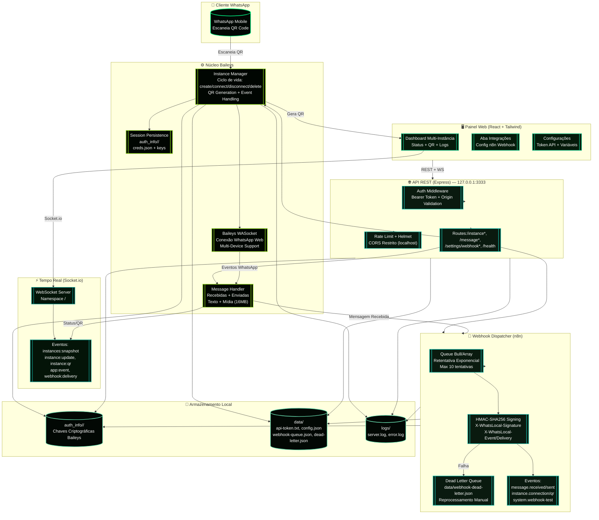

<p align="center">
  
</p>

<p align="center">
  <a href="https://github.com/lcszero44-cell/nexuszap-pro-local/releases"></a>
  <a href="https://github.com/lcszero44-cell/nexuszap-pro-local/blob/main/LICENSE"></a>
  <a href="https://github.com/lcszero44-cell/nexuszap-pro-local/stargazers"></a>
  <a href="https://github.com/lcszero44-cell/nexuszap-pro-local/issues"></a>
  <br/>
  <a href="https://nodejs.org/"></a>
  <a href="https://expressjs.com/"></a>
  <a href="https://socket.io/"></a>
  <a href="https://github.com/WhiskeySockets/Baileys"></a>
  <a href="https://react.dev/"></a>
  <a href="https://vitejs.dev/"></a>
  <a href="https://tailwindcss.com/"></a>
  <a href="https://github.com/lcszero44-cell/nexuszap-pro-local"></a>
  <a href="https://github.com/lcszero44-cell/nexuszap-pro-local"></a>
</p>

---

## 🎯 O que é o NexusZap Pro Local?

**NexusZap Pro Local** é um **gateway WhatsApp Web local** com painel de controle web, API REST e webhooks assinados para **n8n**. Gerencia múltiplas instâncias simultâneas, exibe QR Code no navegador e mantém **100% dos dados no seu computador** — zero nuvem, zero telemetria.

> ⚠️ **Importante:** Baileys é uma biblioteca independente e não oficial, não é a WhatsApp Business Platform nem tem vínculo com a Meta. O protocolo pode mudar, e o uso automatizado pode violar os termos aplicáveis ou causar restrições da conta. Use somente com contas autorizadas e contatos que esperam receber mensagens. Não use para spam, disparos em massa ou vigilância. Para operação comercial crítica, prefira a WhatsApp Business Platform oficial.

---

## 🏗️ Arquitetura do Sistema



---

## ⚡ Principais Funcionalidades

<details open>
<summary><strong>📱 Múltiplas Instâncias WhatsApp</strong></summary>

- Gerencie **várias sessões simultâneas** (atendimento, vendas, suporte, pessoal)
- Cada instância isolada com sua própria pasta `auth_info/<id>/` (chaves criptográficas Baileys)
- Criação, conexão, desconexão e exclusão via painel ou API
- Detecção automática de desconexão (`logged_out`) com alerta no dashboard

</details>

<details open>
<summary><strong>📷 QR Code no Painel (Visual Pairing)</strong></summary>

- QR Code renderizado **em tempo real** no dashboard (string + Data URL PNG)
- Atualização automática a cada refresh de conexão
- Botão "Atualizar QR" para forçar novo código
- Instruções visuais passo a passo para pareamento no WhatsApp Mobile

</details>

<details open>
<summary><strong>🌐 API REST Completa</strong></summary>

| Endpoint | Método | Descrição |
|----------|--------|-----------|
| `/health` | `GET` | Health check (sem token) |
| `/instance/fetch-instances` | `GET` | Listar todas as instâncias |
| `/instance/create` | `POST` | Criar instância `{ "name": "atendimento" }` |
| `/instance/connect` | `POST` | Conectar/renovar QR `{ "instanceId": "atendimento", "refresh": true }` |
| `/instance/disconnect` | `POST` | Desconectar instância |
| `/instance/:id/qr` | `GET` | Obter QR (string + data URL PNG) |
| `/instance/delete` | `POST` | Excluir instância e sessão local |
| `/message/send-text` | `POST` | Enviar mensagem de texto |
| `/message/send-media` | `POST` | Enviar mídia (imagem, vídeo, áudio, documento) |
| `/settings/webhook` | `GET` | Ver configuração do webhook n8n |
| `/settings/webhook` | `PUT` | Configurar webhook n8n (URL + segredo HMAC) |
| `/settings/webhook/test` | `POST` | Enviar evento de teste para n8n |
| `/settings/webhook/clear-secret` | `POST` | Remover segredo HMAC |

**Autenticação:** Header `Authorization: Bearer SEU_TOKEN_LOCAL` (64 chars hex, gerado na 1ª execução)

</details>

<details>
<summary><strong>🔗 Webhooks para n8n (HMAC-SHA256 + Retentativas)</strong></summary>

### Envelope do Webhook
```json
{
  "id": "uuid-da-entrega",
  "event": "message.received",
  "timestamp": "2026-01-01T12:00:00.000Z",
  "data": {
    "instanceId": "atendimento",
    "instanceName": "Atendimento",
    "messageId": "id-da-mensagem",
    "from": "5511999999999@s.whatsapp.net",
    "pushName": "Contato",
    "text": "Olá",
    "messageType": "conversation",
    "timestamp": "2026-01-01T11:59:58.000Z"
  }
}
```

### Headers de Segurança
| Header | Descrição |
|--------|-----------|
| `X-WhatsLocal-Event` | Nome do evento (ex: `message.received`) |
| `X-WhatsLocal-Delivery` | UUID único da entrega |
| `X-WhatsLocal-Signature` | `sha256=<hex>` — HMAC-SHA256 do corpo JSON com segredo compartilhado |

### Eventos Disponíveis
- `message.received` — Mensagem recebida
- `message.sent` — Mensagem enviada (pela API)
- `instance.connection` — Conexão/desconexão/`logged_out`
- `instance.qr` — Novo QR Code gerado
- `system.webhook-test` — Teste de conectividade

### Retentativas & Dead Letter
- **Backoff exponencial** — até 10 tentativas (1s, 2s, 4s, 8s, 16s, 32s, 64s, 128s, 256s, 512s)
- **Dead Letter Queue** — Falhas finais vão para `data/webhook-dead-letter.json` para reprocessamento manual

### Validar Assinatura no n8n (Nó Code)
```javascript
const crypto = require('crypto');
const secret = $credentials.webhookSecret; // Configure como credencial
const signature = $request.headers['x-whatslocal-signature'];
const body = JSON.stringify($request.body);
const expected = 'sha256=' + crypto.createHmac('sha256', secret).update(body).digest('hex');

// Comparação em tempo constante (recomendado para produção)
const match = crypto.timingSafeEqual(Buffer.from(signature), Buffer.from(expected));
if (!match) throw new Error('Assinatura inválida');
```

</details>

<details>
<summary><strong>⚡ Tempo Real com Socket.io</strong></summary>

Conecte com `socket.io-client`:
```javascript
import { io } from 'socket.io-client';

const socket = io('http://127.0.0.1:3333', {
  auth: { token: 'SEU_TOKEN_LOCAL' },
  transports: ['websocket', 'polling']
});

socket.on('instances:snapshot', (instances) => console.log(instances));
socket.on('instance:update', (instance) => console.log('Status:', instance.status));
socket.on('instance:qr', ({ instanceId, qr, imageDataUrl }) => console.log('QR:', qr));
socket.on('app:event', (event) => console.log('Evento:', event.event, event.data));
socket.on('webhook:delivery', (delivery) => console.log('Webhook:', delivery.state));
```

**Eventos:**
- `instances:snapshot` — Lista inicial ao conectar
- `instance:update` — Mudança de status/telefone/QR
- `instance:qr` — Novo QR Code (string + data URL PNG)
- `instance:deleted` — Instância removida
- `app:event` — Todos os eventos de webhook
- `webhook:delivery` — Status de entrega do webhook

</details>

<details>
<summary><strong>🛡️ Segurança Local (Zero Nuvem)</strong></summary>

- **Bind padrão:** `127.0.0.1:3333` — não acessível de fora da máquina
- **Token Bearer:** Gerado automaticamente na primeira execução (64 chars hex)
- **Validação de origem:** API e Socket.io aceitam apenas `localhost:3333` / `127.0.0.1:3333`
- **HMAC-SHA256:** Webhooks assinados para autenticar o remetente
- **Dados sensíveis protegidos no `.gitignore`:**
  - `auth_info/` — Chaves privadas Baileys por instância
  - `data/` — Token API, config, fila webhook, dead-letter
  - `logs/` — Logs de execução
- **Limite de mídia:** 16 MB por arquivo (download via URL ou Base64)

> ⚠️ **Docker/n8n:** Se precisar acessar de outro container, use `HOST=0.0.0.0` no `.env`. Isso expõe a porta na rede local. **Proteja o token**, configure firewall e não use em redes não confiáveis. URL no container: `http://host.docker.internal:3333`

</details>

---

## 📦 Estrutura do Projeto

```
whatslocal/
├── start.bat              # Inicializador Windows (instala, builda, inicia)
├── run-server.bat         # Inicia apenas o servidor (logs em logs/server.log)
├── package.json
├── vite.config.js         # Config Vite + proxy para desenvolvimento
├── .env.example           # Exemplo de variáveis de ambiente
├── .gitignore
├── assets/
│   └── banner.svg         # Banner 3D Hero (este arquivo)
├── src/
│   ├── server/            # Backend (Express + Socket.io + Baileys)
│   │   ├── index.js       # Bootstrap do servidor
│   │   ├── config.js      # Diretórios, portas, token API
│   │   ├── security.js    # Middleware de auth + validação de origem
│   │   ├── routes/api.js  # Rotas REST
│   │   ├── services/
│   │   │   ├── instance-manager.js    # Ciclo de vida Baileys, QR, mensagens
│   │   │   └── webhook-dispatcher.js  # Fila, retentativas, HMAC, dead-letter
│   │   └── utils/http.js  # Helpers de erro e resposta
│   └── client/            # Frontend (React + Tailwind)
│       ├── index.html
│       ├── main.jsx
│       ├── App.jsx        # Dashboard completo
│       ├── api.js         # Cliente API + Socket.io
│       └── styles.css     # Tailwind + estilos customizados
├── auth_info/             # Sessões criptográficas por instância (NÃO COMMITAR)
├── data/                  # Token API, config, fila webhook, dead-letter (NÃO COMMITAR)
├── logs/                  # Logs de execução (NÃO COMMITAR)
└── dist/                  # Build de produção do frontend (gerado pelo build)
```

---

## 🚀 Instalação Rápida

<details>
<summary><strong>🪟 Windows (Recomendado)</strong></summary>

```powershell
# 1. Clone o repositório
git clone https://github.com/lcszero44-cell/nexuszap-pro-local.git
cd nexuszap-pro-local/whatslocal

# 2. Execute o instalador automático
start.bat
```

**O `start.bat` faz tudo automaticamente:**
- ✅ Verifica Node.js ≥ 20.19
- ✅ `npm install` (dependências)
- ✅ `npm run build` (compila React + Vite)
- ✅ Inicia servidor em background
- ✅ Abre painel em `http://localhost:3333/dashboard`

**3. No painel:** Clique **Nova instância** → dê um nome → escaneie o QR Code no WhatsApp:
- Abra WhatsApp no celular
- **Aparelhos conectados → Conectar aparelho**
- Escaneie o QR Code exibido

</details>

<details>
<summary><strong>🐧 Linux / macOS / Desenvolvimento</strong></summary>

```bash
# 1. Clone e entre na pasta
git clone https://github.com/lcszero44-cell/nexuszap-pro-local.git
cd nexuszap-pro-local/whatslocal

# 2. Instale dependências
npm install

# 3. Compile o painel (produção)
npm run build

# 4. Inicie o servidor
npm start
```

**Para desenvolvimento com Hot Reload (dois terminais):**
```bash
# Terminal 1: API + Socket.io
npm start

# Terminal 2: Vite dev server (proxy para API)
npm run dev
```
Painel em `http://localhost:5173` (proxy para `127.0.0.1:3333`)

</details>

<details>
<summary><strong>⚙️ Variáveis de Ambiente (.env)</strong></summary>

Crie `.env` na raiz (baseado no `.env.example`):

```env
# Padrão seguro: servidor acessível somente neste computador.
HOST=127.0.0.1
LOG_LEVEL=warn

# Para Docker/n8n acessar (use com cautela):
# HOST=0.0.0.0
```

</details>

---

## 📚 Exemplos de Uso da API

<details>
<summary><strong>📝 Enviar Texto</strong></summary>

```bash
curl -X POST http://127.0.0.1:3333/message/send-text \
  -H "Authorization: Bearer SEU_TOKEN" \
  -H "Content-Type: application/json" \
  -d '{
    "instanceId": "atendimento",
    "to": "5511999999999",
    "text": "Olá! **Negrito**, *itálico*, ~~tachado~~ e `código`."
  }'
```

</details>

<details>
<summary><strong>🖼️ Enviar Imagem por URL</strong></summary>

```bash
curl -X POST http://127.0.0.1:3333/message/send-media \
  -H "Authorization: Bearer SEU_TOKEN" \
  -H "Content-Type: application/json" \
  -d '{
    "instanceId": "atendimento",
    "to": "5511999999999",
    "kind": "image",
    "url": "https://exemplo.com/imagem.jpg",
    "mimetype": "image/jpeg",
    "caption": "Legenda opcional"
  }'
```

> **Formato do número:** Internacional (código país + DDD + número, só dígitos). Ex: `5511999999999` ou `5511999999999@s.whatsapp.net`
> **Limite de mídia:** 16 MB

</details>

<details>
<summary><strong>🔧 Configurar Webhook n8n via API</strong></summary>

```bash
curl -X PUT http://127.0.0.1:3333/settings/webhook \
  -H "Authorization: Bearer SEU_TOKEN" \
  -H "Content-Type: application/json" \
  -d '{
    "url": "https://seu-n8n.com/webhook/whatsapp",
    "secret": "segredo-super-seguro-compartilhado"
  }'
```

**Testar webhook:**
```bash
curl -X POST http://127.0.0.1:3333/settings/webhook/test \
  -H "Authorization: Bearer SEU_TOKEN"
```

</details>

---

## 🐛 Solução de Problemas

| Problema | Solução |
|----------|---------|
| **Porta 3333 ocupada** | Feche o processo `node.exe` no Gerenciador de Tarefas ou `npx kill-port 3333` |
| **QR não aparece** | Clique em "Atualizar QR" ou desconecte/conecte a instância |
| **Webhook não chega no n8n** | Verifique URL, segredo HMAC, firewall e logs em `logs/server.log` |
| **Sessão não restaura** | Apague a pasta `auth_info/<id>` e reconecte (gera novo QR) |
| **Erro de build (Vite/React)** | `rm -rf node_modules package-lock.json && npm install` |
| **Token inválido** | Token fica em `data/api-token.txt` — copie do botão "Token API" no painel |
| **Baileys desconecta sozinho** | Verifique versão do Node.js (≥20.19), conexão internet, e se WhatsApp Web está funcionando no navegador |

---

## 📄 Licença

MIT — veja [LICENSE](LICENSE).

---

## 🤝 Contribuição

1. Fork o projeto
2. Crie branch: `git checkout -b feature/minha-feature`
3. Commit: `git commit -m 'feat: minha feature incrível'`
4. Push: `git push origin feature/minha-feature`
5. Abra Pull Request

---

## 📞 Suporte & Comunidade

- **Issues**: [GitHub Issues](https://github.com/lcszero44-cell/nexuszap-pro-local/issues) — Bugs, sugestões, dúvidas
- **Discussões**: [GitHub Discussions](https://github.com/lcszero44-cell/nexuszap-pro-local/discussions) — Casos de uso, configs n8n, dicas

---

## 🏷️ Stack Tecnológica

| Camada | Tecnologias |
|--------|-------------|
| **Runtime** | Node.js 20.19+ / 22 LTS |
| **Backend** | Express 4.x, Socket.io 4.x, Baileys (WhiskeySockets) |
| **Frontend** | React 18, Vite 5, Tailwind CSS 3 |
| **Autenticação** | Bearer Token (64-char hex), Origin Validation |
| **Webhooks** | HMAC-SHA256, Retentativa Exponencial, Dead Letter Queue |
| **Persistência** | Sistema de arquivos local (JSON, auth_info Baileys) |
| **Build** | Vite (produção), PyInstaller-style scripts (.bat para Windows) |
| **Segurança** | Helmet, CORS restrito, Rate Limit, Bind localhost |

---

<p align="center">
  <strong>Desenvolvido com ❤️ para automações locais de WhatsApp — privacidade total, controle total.</strong>
</p>

<p align="center">
  <strong>NexusZap Pro Local</strong> — Seu WhatsApp, sua API, suas regras. 100% Local.
</p>